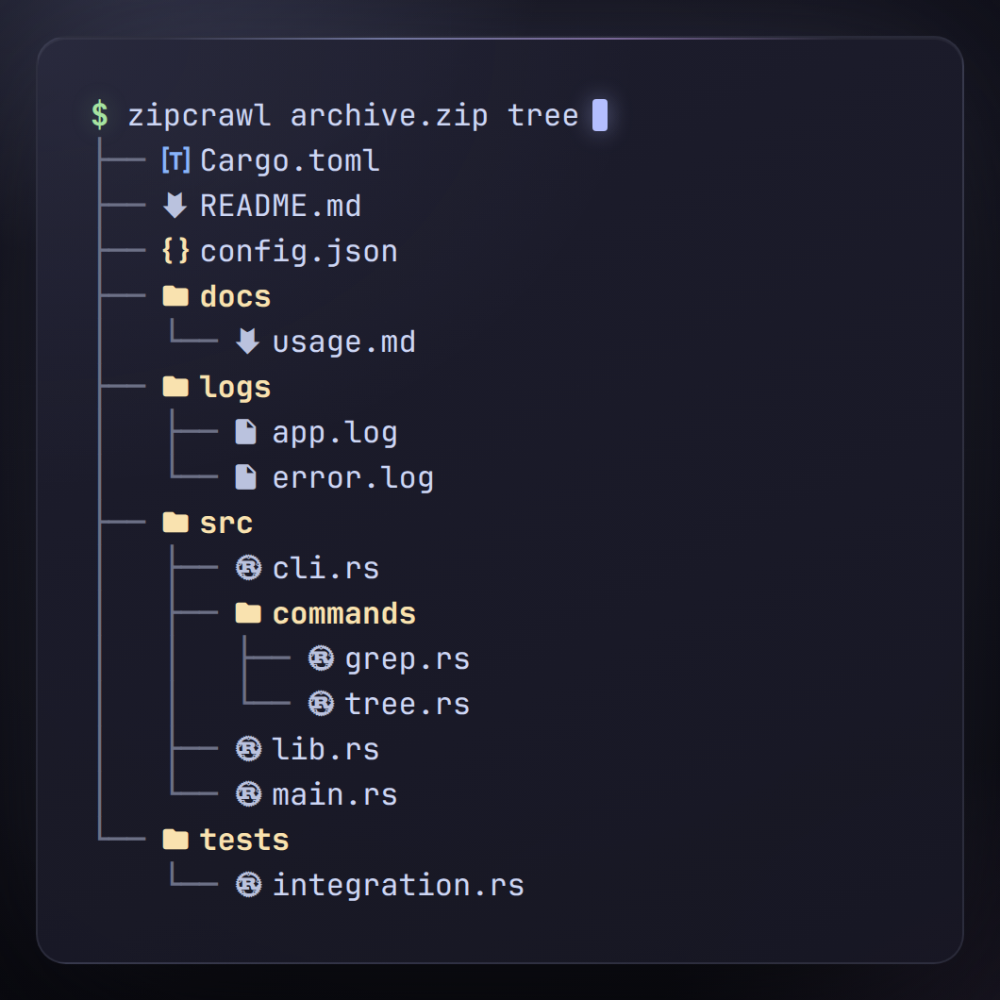
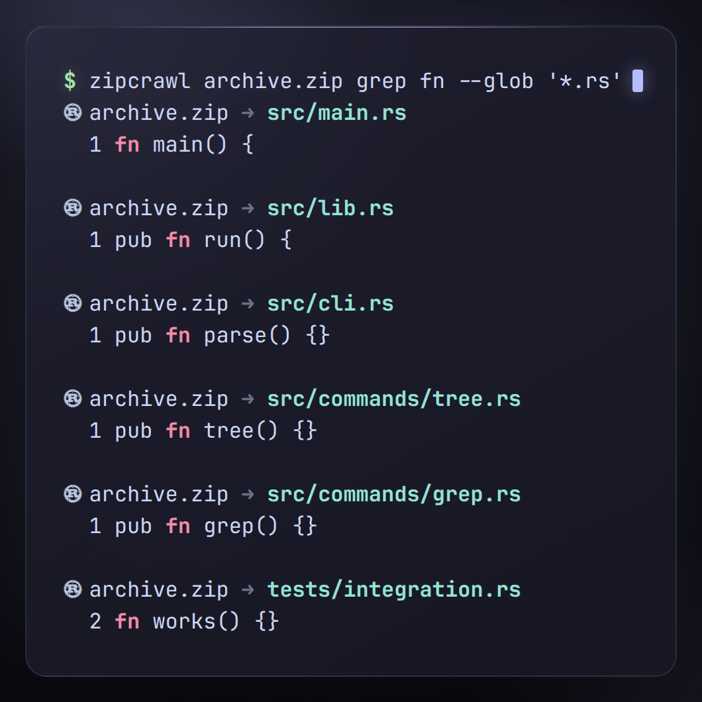
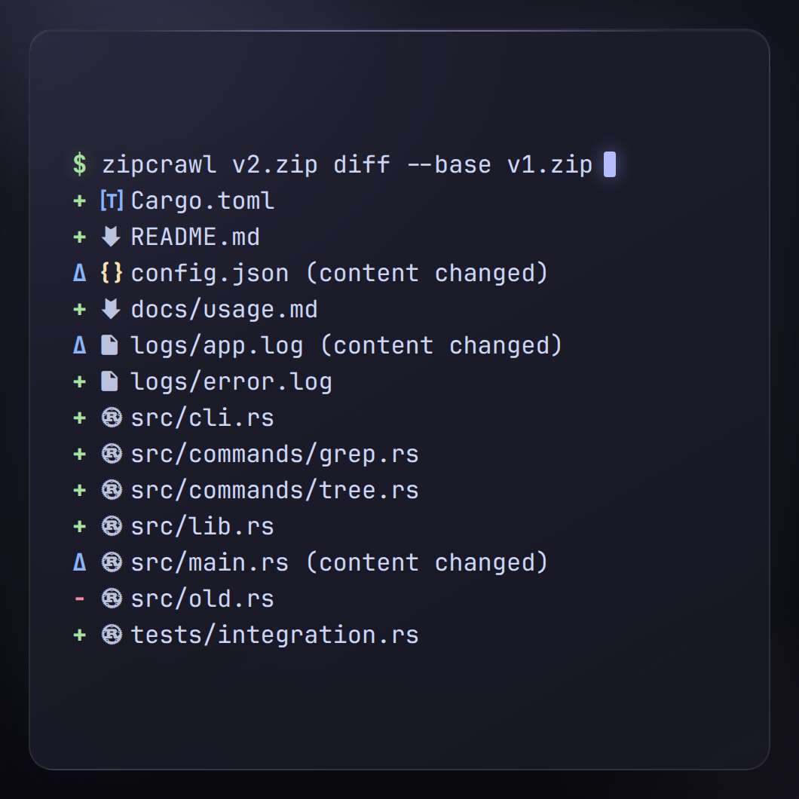
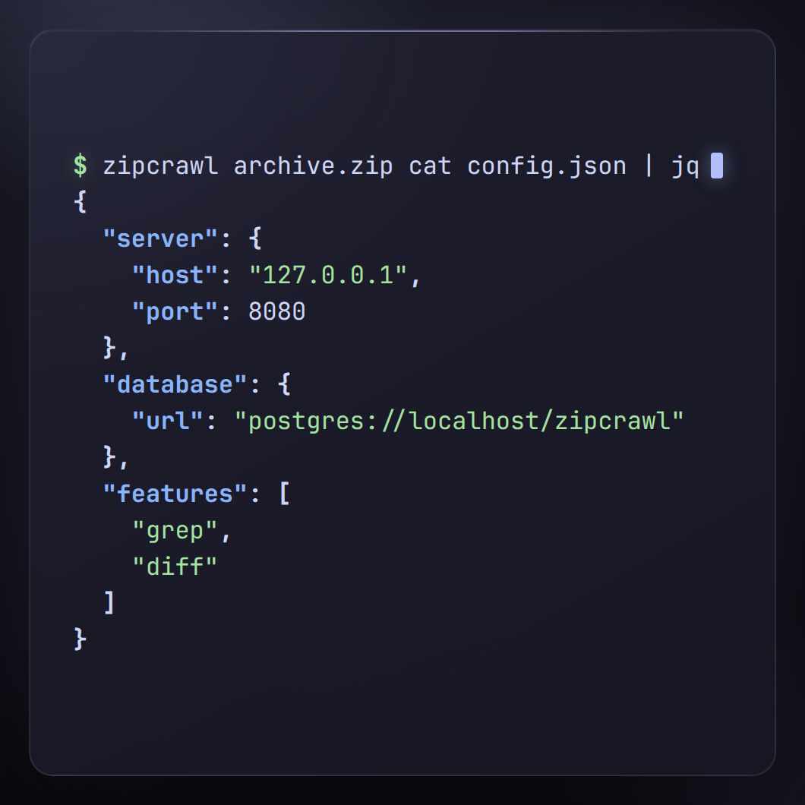

<div align="center">

# zipcrawl

**Ergonomic API/Cli for ZIP archives**

[](https://crates.io/crates/zipcrawl)
[](https://github.com/SirCesarium/zipcrawl/actions/workflows/ci.yml)

</div>


`zipcrawl` treats a ZIP archive like a directory in your terminal. The archive path comes first, then the command you already know:

```bash
zipcrawl archive.zip tree
zipcrawl archive.zip grep "TODO" --glob "*.rs"
zipcrawl archive.zip cat config.json | jq .server.port
zipcrawl v2.zip diff --base v1.zip
```

Use it to inspect release artifacts, JARs, mod packs, and log bundles. Rust code gets the same entry access through the library API.

<div align="center">
  
  &nbsp;&nbsp;
  
</div>

## CLI behavior

Every command has the same shape: `zipcrawl <archive> <command> [args]`.

- Several archives at once. `zipcrawl v1.zip v2.zip list` runs the command on each archive, prints an archive header before each one, and a separator after it. `-q` on `cat`, `x`, and `diff` removes the header and separator.
- Globs match the full entry path. `find '*.rs' -g` and `grep "TODO" --glob '*.rs'` reach nested files. `cat`, `bat`, and `x` accept globs too.
- Content goes to stdout. `cat` writes raw bytes and `x` writes into a child process. zipcrawl writes no temporary file in either case.
- `bat` and `diff` use a pager. `diff -q` prints without one.
- zipcrawl exits 1 when an archive cannot be opened or a zipcrawl command fails.

<div align="center">
  
  &nbsp;&nbsp;
  
</div>

## Commands

| Command | Aliases | What it does |
|---------|---------|--------------|
| `tree` | `t` | Directory tree |
| `list` | `ls`, `l` | Flat entry listing, sorted by name |
| `cat` | | Stream matching entries to stdout (raw) |
| `bat` | | Stream matching entries with syntax highlighting and line numbers |
| `find` | `fd`, `f` | Match entry names with a regex, or a glob with `-g` |
| `grep` | `g` | Search file contents with a regex |
| `x` | `exec` | Pipe a matching entry into a command's stdin |
| `diff` | `d` | Compare against a base archive |
| `completions` | `completion` | Generate shell completion scripts |

## Flags

| Flag | Command | What it does |
|------|---------|--------------|
| `-s`, `--sizes` | `tree`, `list` | Show sizes and a proportion bar |
| `-d`, `--depth` | `tree` | Maximum depth (default 4) |
| `-g`, `--glob` | `find` | Treat the pattern as a glob instead of a regex |
| `-g`, `--glob <GLOB>` | `grep` | Only search entries matching this glob |
| `-p`, `--path` | `find`, `grep` | Restrict to entries whose path starts with this prefix |
| `-t`, `--entry-type` | `find` | `f` for files, `d` for directories |
| `-q`, `--quiet` | `cat`, `x`, `diff` | Suppress headers and separators; `cat` and `x` also hide file-not-found errors; `diff` skips the pager |
| `-b`, `--base` | `diff` | Base archive for comparison |
| `-m`, `--mode` | `diff` | `default`, `structure`, `stats`, or `full` |
| `-i`, `--include` | `diff` | Comma-separated glob patterns to include |
| `-e`, `--exclude` | `diff` | Comma-separated glob patterns to exclude |

## Diff modes

| Mode | Output |
|------|--------|
| `default` | Added and removed entries, plus `content changed` when the CRC differs |
| `structure` | Added and removed entries only |
| `stats` | Added and removed entries, plus size changes |
| `full` | Added and removed entries, size changes, `content changed`, and line-by-line diffs for text entries |

## Examples

For `find`, regex matching is the default. Add `-g` to use a glob instead.

```bash
zipcrawl archive.zip find '\.rs$'
```

Output:

```
src/main.rs
src/deep/helper.rs
```

`cat` writes raw bytes, so any program that reads stdin works.

```bash
zipcrawl archive.zip cat config.json | jq .server.port
```

Output:

```
8080
```

`x` passes the entry to the command's stdin. Use `--` before arguments that zipcrawl would parse as its own flags.

```bash
zipcrawl archive.zip x config.json -- python3 -m json.tool
```

## Features

- Read, search, and stream entries without extracting the archive.
- One command shape, `zipcrawl <archive> <command>`, across `tree`, `list`, `find`, `grep`, `cat`, `bat`, `x`, and `diff`.
- Zip-bomb and path-traversal guards on every entry read.
- The same entry access from Rust through `ZipManager`.

Cargo features:

| Feature | Default | Adds |
|---------|---------|------|
| `cli` | yes | The `zipcrawl` binary |
| `nerdfonts` | yes | File-type icons in CLI output |
| `exec` | yes | The `x` command |
| `compress` | no | `ZipCompressor` |
| `serde` | no | JSON and TOML helpers |
| `full-zip` | no, enabled by `cli` | bzip2, deflate64, lzma, ppmd, xz, zstd, and AES |

## Install

### Quick downloads

<div align="center">

<a href="https://github.com/SirCesarium/zipcrawl/releases/latest/download/zipcrawl-windows-x86_64.msi"></a>
<a href="https://github.com/SirCesarium/zipcrawl/releases/latest/download/zipcrawl-linux-amd64.deb"></a>
<a href="https://github.com/SirCesarium/zipcrawl/releases/latest/download/zipcrawl-linux-x86_64.rpm"></a>
<a href="https://github.com/SirCesarium/zipcrawl/releases/latest/download/zipcrawl-macos-arm64"></a>

</div>

Every prebuilt binary ships with all features: NerdFont icons, `x`, shell completions, and every compression method `zip` supports.

| Platform | Asset |
| --- | --- |
| Windows x86_64 | `zipcrawl-windows-x86_64.msi` or `zipcrawl-windows-x86_64.exe` |
| Debian/Ubuntu | `zipcrawl-linux-amd64.deb` or `zipcrawl-linux-arm64.deb` |
| Fedora/RHEL | `zipcrawl-linux-x86_64.rpm` or `zipcrawl-linux-aarch64.rpm` |
| macOS | `zipcrawl-macos-arm64` or `zipcrawl-macos-x86_64` |
| Linux (musl) | `zipcrawl-linux-x86_64-musl` or `zipcrawl-linux-arm64-musl` |

### Install script

```bash
curl -fsSL https://raw.githubusercontent.com/SirCesarium/zipcrawl/main/scripts/install.sh | bash
```

The script downloads the prebuilt binary for your platform, installs it to `~/.local/bin`, and adds completions for fish, zsh, and bash when those shells are present. Set `ZIPCRAWL_BIN_DIR` to change the install directory. On platforms without a prebuilt binary it falls back to `cargo install`.

### With Cargo

```bash
cargo install zipcrawl
```

Default features include NerdFont icons and the `x` command.

## Completions

The install script adds entry-path completion for `cat`, `bat`, and `x` to fish, zsh, and bash. To generate the standard completion scripts yourself:

```bash
# fish
zipcrawl completions fish > ~/.config/fish/completions/zipcrawl.fish

# zsh
zipcrawl completions zsh > "${XDG_DATA_HOME:-$HOME/.local/share}/zsh/site-functions/_zipcrawl"

# bash (add to ~/.bashrc)
eval "$(zipcrawl completions bash)"
```

For zsh, keep the target directory in `$fpath`. `completions` also accepts `elvish` and `powershell`. The generated scripts complete commands and flags. They do not read entry names from the archive; the install script adds that.

## Library

Add the crate without the CLI dependencies:

```toml
[dependencies]
zipcrawl = { version = "4", default-features = false }
```

Open an archive from a file and stream an entry:

```rust
use std::io;
use std::path::Path;
use zipcrawl::{ZipCrawlError, ZipManager};

fn main() -> Result<(), ZipCrawlError> {
    let mut archive = ZipManager::new(Path::new("build.zip"))?;

    for entry in archive.entries()? {
        println!("{} ({} bytes)", entry.name, entry.size);
    }

    archive.stream_file("config.json", |reader| {
        io::copy(reader, &mut io::stdout())
            .map(|_| ())
            .map_err(|source| ZipCrawlError::IoError {
                path: "config.json".into(),
                source,
            })
    })?;

    Ok(())
}
```

`ZipManager` opens a file with `new` or buffers any `Read` source with `from_reader`. Opening an entry rejects `..` paths and entries that exceed the expansion limits. `stream_file` gives you a `Read` handle instead of loading the entry into memory, `read_to_string` loads one entry into a `String`, and `extract_prefix` writes a subtree to disk.

With the `compress` feature, `ZipCompressor` writes to a temporary file and renames it on `finish`. With `serde`, `read_and_deserialize` and `serialize_and_add` handle JSON and TOML.

See [Features](#features) for the Cargo feature flags. With `default-features = false`, the library reads stored and deflate entries. Enable `full-zip` for the other methods.

## Limits

- ZIP only. tar, tar.gz, 7z, and rar are not supported.
- The CLI has no extract command and no command that creates or modifies a ZIP. `extract_prefix` and `ZipCompressor` are library APIs.
- Opening an entry for reading rejects it if its declared uncompressed size is over 1 GiB or its declared compression ratio is over 100:1. Paths that escape the archive root are rejected.
- `diff --mode full` runs line-by-line diffs only when the CRC differs, the extension is `toml`, `json`, `txt`, `rs`, `js`, `properties`, or `md`, and both versions are under 500,000 bytes.

## License

Distributed under the [MIT License](LICENSE).
